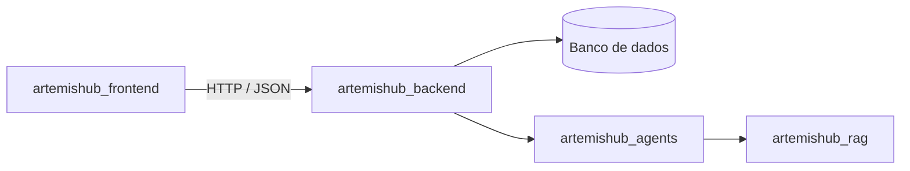

# 🌙 Artemis — Backend

### API da plataforma Artemis 💜

Este repositório contém a **API** do Artemis: a camada que conecta a interface web aos agentes de IA e à base de conhecimento, além de cuidar das regras de negócio, da autenticação e da persistência dos dados.

> 🚧 **Em desenvolvimento.** Hoje existem `GET /health`, o cadastro com consentimento (`POST /v1/auth/cadastro`), o login (`POST /v1/auth/login`), o banco Postgres (tabelas `usuarias`, `conversas` e `mensagens`), as migrações e as rotas de conversas (criar, listar, abrir, apagar e perguntar), todas protegidas por token. A pergunta chama o serviço de agentes por HTTP, mas o contrato ainda é um rascunho ([artemishub_agents#36](https://github.com/ArtemisHubApp/artemishub_agents/issues/36)) e o endpoint de lá ainda não existe: nos testes os agentes são simulados. Também existem `GET /v1/consentimento` e a exclusão da conta (`DELETE /v1/conta`). O texto do consentimento ainda precisa ser revisado pela equipe no ADR de LGPD. O compose com Postgres e backend é a [backend#11](https://github.com/ArtemisHubApp/artemishub_backend/issues/11) e ainda não existe.

## 🎯 Responsabilidades

- 🔐 **Autenticação e contas:** cadastro, login e gestão do perfil da usuária.
- 📄 **Upload de currículo e documentos:** recebimento e armazenamento seguro dos arquivos enviados.
- 🤖 **Orquestração das chamadas de IA:** encaminhar as solicitações ao `artemishub_agents` e devolver respostas com as fontes citadas.
- 💾 **Persistência:** histórico de conversas, análises de perfil e simulações de negociação.
- 🛡️ **Privacidade e segurança:** proteção de dados pessoais (LGPD), validação de entrada e controle de acesso.

## 🔌 Integrações



## 🧰 Stack

Python 3.12, [uv](https://docs.astral.sh/uv/), FastAPI, SQLAlchemy 2 (async) com asyncpg, Alembic e Postgres 16. Testes com pytest e testcontainers. O código segue camadas `domain`, `application` e `adapters`, com as dependências apontando para dentro. As decisões ficam como ADR no [artemishub_docs](https://github.com/ArtemisHubApp/artemishub_docs).

## ▶️ Como executar

1. Instale as dependências: `uv sync`.
2. Suba um Postgres local (só para desenvolvimento; troque a senha):

   ```bash
   docker run --name artemis-postgres -e POSTGRES_USER=artemis -e POSTGRES_PASSWORD=<senha> \
     -e POSTGRES_DB=artemis -p 5432:5432 -d postgres:16
   ```

3. Copie `.env.example` para `.env` e preencha as variáveis: `DATABASE_URL`, `ARTEMIS_JWT_SEGREDO`, `ARTEMIS_AGENTS_URL` e `ARTEMIS_AGENTS_TOKEN`. `ARTEMIS_JWT_SEGREDO` e `ARTEMIS_AGENTS_TOKEN` vêm vazios no `.env.example` de propósito: gere o segredo (`openssl rand -base64 48`, ou `python -c "import secrets; print(secrets.token_urlsafe(48))"` no Windows) e peça o token dos agentes à equipe. A API não sobe sem `ARTEMIS_JWT_SEGREDO`, que precisa ter pelo menos 32 bytes. Na `DATABASE_URL`, a `<senha>` é a mesma `POSTGRES_PASSWORD` do passo 2. Nunca commite o `.env`.
4. Aplique as migrações: `uv run --env-file .env alembic upgrade head`.
5. Inicie a API: `uv run --env-file .env uvicorn artemis_backend.main:app_de_ambiente --factory`. Teste em `http://localhost:8000/health`.

### Rotas de autenticação

| Rota | Corpo | Resposta |
|---|---|---|
| `POST /v1/auth/cadastro` | `email`, `senha` (8 a 128 caracteres), `consentimento` (precisa ser o booleano `true`) | 201 com `{"id": ...}`; 409 se o e-mail já existe; 422 se algo for inválido |
| `POST /v1/auth/login` | `email`, `senha` | 200 com `{"token": ..., "tipo": "bearer"}` (JWT de 60 minutos, sem refresh); 401 para senha errada ou e-mail sem conta, com a mesma resposta |

O e-mail é normalizado (espaços e maiúsculas) no cadastro e no login. A senha é guardada com argon2. As respostas 422 não repetem o que foi enviado. O cadastro repetido usa `INSERT ... ON CONFLICT DO NOTHING`, para o e-mail não aparecer no log do Postgres.

### Consentimento e exclusão da conta

| Rota | Resposta |
|---|---|
| `GET /v1/consentimento` | 200 com `{"texto": ...}`. Pública, para ser lida antes do cadastro. O texto cita o Google Gemini e o Langfuse, que recebem o texto das perguntas |
| `DELETE /v1/conta` | Exige token. 204 e apaga a conta, as conversas e as mensagens, sem volta; 401 sem token válido, inclusive numa segunda exclusão da mesma conta. O e-mail pode ser cadastrado de novo, sem as conversas antigas |

**O que a exclusão não apaga:** os traces do Langfuse permanecem, e o texto do consentimento diz isso. O texto é provisório: a equipe o revisa no ADR de LGPD. Depois da exclusão, o token continua assinado, mas responde 401 em todas as rotas.

### Rotas de conversas

Exigem `Authorization: Bearer <token>` (401 sem token válido). Cada usuária só enxerga as próprias conversas: a de outra usuária responde 404, igual a uma que não existe.

| Rota | Resposta |
|---|---|
| `POST /v1/conversas` | 201 com a conversa vazia: `id`, `titulo` (nulo até a primeira pergunta), `criada_em`, `atualizada_em` |
| `GET /v1/conversas` | 200 com a lista da usuária, da mais recente para a mais antiga (por `atualizada_em`) |
| `GET /v1/conversas/{id}` | 200 com a conversa e `mensagens` em ordem cronológica (`id`, `papel`, `texto`, `criada_em`, `aprovada`, `bloqueada`, `pergunta_id`); 404; 422 se o id não for um UUID |
| `DELETE /v1/conversas/{id}` | 204 e apaga as mensagens, sem volta; 404 se não existe ou já foi apagada |
| `POST /v1/conversas/{id}/mensagens` | corpo `{"pergunta": "..."}` (até 1.000 caracteres, com espaços das pontas removidos ao guardar); 201 com `pergunta` e `resposta`, cada uma com os campos das mensagens acima; 404 (também se a conversa for apagada durante a resposta); 409 se já há uma pergunta em andamento na conversa ou se ela passou de 60 s e outra tomou o lugar; 422 para pergunta vazia, longa ou com caractere inválido |

A Artemis recebe até 3 trocas anteriores aprovadas da mesma conversa, a lembrança guardada e o id da conversa, nunca o e-mail nem o id da usuária. Se os agentes falharem ou passarem de 60 s no total, a resposta é 201 com "Não consegui responder agora, tente de novo" e `aprovada` falso, sem nova tentativa. A trava da conversa expira em 60 s, então uma queda da API não a deixa presa. O contrato com os agentes fica em [contratos/responder.v1.schema.json](contratos/responder.v1.schema.json).

Se o banco recusar, cair ou não responder (5 s para conectar, 10 s por comando), a API responde 503.

As datas saem em UTC (`...Z`). A lista ainda não tem paginação.

Nova migração: `uv run --env-file .env alembic revision --autogenerate -m "<descrição>"` e revise o arquivo gerado.

## 🧪 Testes

`uv run pytest -q`. Os testes sobem um Postgres 16 descartável com testcontainers, então **o Docker precisa estar rodando**. Antes do PR: `uv run ruff check . && uv run ruff format --check . && uv lock --check`.

## 📋 Contribuindo

As tarefas são acompanhadas no [kanban do projeto](https://github.com/orgs/ArtemisHubApp/projects). Ao abrir um PR, inclua `Closes #<número>` na descrição para que a issue seja movida automaticamente.

## 🗂️ Repositórios do projeto

| Repositório | Responsabilidade |
|---|---|
| [artemishub_docs](https://github.com/ArtemisHubApp/artemishub_docs) | Documentação, decisões de arquitetura e kanban do projeto |
| [artemishub_frontend](https://github.com/ArtemisHubApp/artemishub_frontend) | Interface web da plataforma |
| [artemishub_backend](https://github.com/ArtemisHubApp/artemishub_backend) | API, regras de negócio, autenticação e persistência |
| [artemishub_agents](https://github.com/ArtemisHubApp/artemishub_agents) | Sistema multiagentes LLM, multimodalidade e modelos de ML |
| [artemishub_rag](https://github.com/ArtemisHubApp/artemishub_rag) | Base de conhecimento, indexação e recuperação com citações |

## 👩‍💻 Nossa equipe

Desenvolvido pelo **Grupo 11**. Todas somos **AI Builders**, cada uma com uma frente principal de atuação:

<table>
  <tr>
    <td align="center">
      <a href="https://github.com/CamilaSilvaC">
        <br/>
        <b>Camila</b>
      </a>
      <br/><sub>Engenharia de Dados · DevOps</sub>
    </td>
    <td align="center">
      <a href="https://github.com/AmandaElisa">
        <br/>
        <b>Amanda</b>
      </a>
      <br/><sub>Fullstack</sub>
    </td>
    <td align="center">
      <a href="https://github.com/anajbsouza">
        <br/>
        <b>Ana Julia</b>
      </a>
      <br/><sub>Ciência de Dados · Engenharia de Dados</sub>
    </td>
    <td align="center">
      <a href="https://github.com/eduardaoliveirazorg-jpg">
        <br/>
        <b>Eduarda</b>
      </a>
      <br/><sub>Ciência de Dados · Arquitetura de Software</sub>
    </td>
  </tr>
</table>

---

<p align="center">
  <i>Artemis — Mais conhecimento, confiança e oportunidades para mulheres em STEM.</i> 💜
</p>
