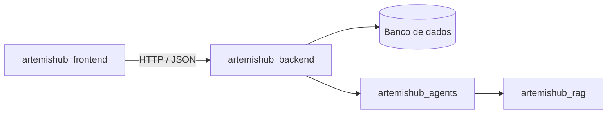

# 🌙 Artemis — Backend

### API da plataforma Artemis 💜

Este repositório contém a **API** do Artemis: a camada que conecta a interface web aos agentes de IA e à base de conhecimento, além de cuidar das regras de negócio, da autenticação e da persistência dos dados.

> 🚧 Em desenvolvimento. A integração completa está prevista para a **semana 6** do roadmap.

## 🎯 Responsabilidades

- 🔐 **Autenticação e contas:** cadastro, login e gestão do perfil da usuária.
- 📄 **Upload de currículo e documentos:** recebimento e armazenamento seguro dos arquivos enviados.
- 🤖 **Orquestração das chamadas de IA:** encaminhar as solicitações ao `artemishub_agents` e devolver respostas com as fontes citadas.
- 💾 **Persistência:** histórico de conversas, análises de perfil e simulações de negociação.
- 🛡️ **Privacidade e segurança:** proteção de dados pessoais (LGPD), validação de entrada e controle de acesso.

## 🔌 Integrações

## 🧰 Stack

A definir pela equipe. As decisões serão registradas como ADR no [artemishub_docs](https://github.com/ArtemisHubApp/artemishub_docs).

## ▶️ Como executar

As instruções de instalação e execução serão adicionadas junto com o primeiro scaffold da API.

## 📋 Contribuindo

As tarefas são acompanhadas no [kanban do projeto](https://github.com/orgs/ArtemisHubApp/projects). Ao abrir um PR, inclua `Closes #<número>` na descrição para que a issue seja movida automaticamente.

## 🗂️ Repositórios do projeto

| Repositório | Responsabilidade |
|---|---|
| [artemishub_docs](https://github.com/ArtemisHubApp/artemishub_docs) | Documentação, decisões de arquitetura e kanban do projeto |
| [artemishub_frontend](https://github.com/ArtemisHubApp/artemishub_frontend) | Interface web da plataforma |
| [artemishub_backend](https://github.com/ArtemisHubApp/artemishub_backend) | API, regras de negócio, autenticação e persistência |
| [artemishub_agents](https://github.com/ArtemisHubApp/artemishub_agents) | Sistema multiagentes LLM, multimodalidade e modelos de ML |
| [artemishub_rag](https://github.com/ArtemisHubApp/artemishub_rag) | Base de conhecimento, indexação e recuperação com citações |

## 👩‍💻 Nossa equipe

Desenvolvido pelo **Grupo 11**. Todas somos **AI Builders**, cada uma com uma frente principal de atuação:

<table>
  <tr>
    <td align="center">
      <a href="https://github.com/CamilaSilvaC">
         
        <b>Camila</b>
      </a>
       Engenharia de Dados · DevOps
    </td>
    <td align="center">
      <a href="https://github.com/AmandaElisa">
         
        <b>Amanda</b>
      </a>
       Fullstack
    </td>
    <td align="center">
      <a href="https://github.com/anajbsouza">
         
        <b>Ana Julia</b>
      </a>
       Ciência de Dados · Engenharia de Dados
    </td>
    <td align="center">
      <a href="https://github.com/eduardaoliveirazorg-jpg">
         
        <b>Eduarda</b>
      </a>
       Ciência de Dados · Arquitetura de Software
    </td>
  </tr>
</table>

---

  <i>Artemis — Mais conhecimento, confiança e oportunidades para mulheres em STEM.</i> 💜

