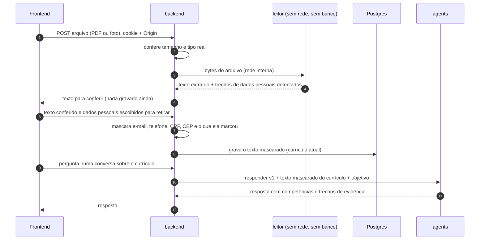

# Design: currículo por PDF ou foto, para conversar sobre ele com a Artemis

**Issue:** ArtemisHubApp/artemishub_backend#3 (RF-03). Relacionadas: ArtemisHubApp/artemishub_agents#14 (leitura multimodal, Ana Julia), ArtemisHubApp/artemishub_agents#21 (segurança do currículo, Eduarda), ArtemisHubApp/artemishub_agents#36 (contrato `responder`), ArtemisHubApp/artemishub_docs#16 (privacidade e retenção do currículo) e ArtemisHubApp/artemishub_frontend#2 (frontend).
**Data:** 26/11/2026. Conversa de desenho com a Amanda. **Aprovado pela Amanda em 26/11/2026.**

## Por que

A usuária quer **conversar com a Artemis sobre o próprio currículo**: o que dá para melhorar, como apresentar uma experiência e quais competências valeria buscar para chegar ao objetivo dela. O currículo não é só um atalho para preencher o perfil: ele vira assunto de conversa, inclusive em dias diferentes.

Ela pode enviar o currículo de dois jeitos: **PDF** ou **foto** do papel tirada no celular.

Requisitos do PDR atendidos: RF-03 (envio de currículo), RF-04 (competências com a evidência usada), RF-05 (síntese do perfil), RF-14 (competências a desenvolver em relação ao objetivo). Também pesam o risco R2 (a usuária hesitar em compartilhar dados) e os RNF-07 e RNF-16 (LGPD e privacidade no processamento por IA).

## Objetivos

1. **Enviar** um currículo em PDF (com texto ou escaneado) ou em foto (JPEG ou PNG).
2. **Conferir** o texto extraído antes de qualquer análise, corrigindo erros de leitura e retirando dados pessoais que ela não quer compartilhar.
3. **Guardar só o texto conferido**, numa área "Meu currículo", até ela substituir, apagar ou excluir a conta. O arquivo original nunca é guardado.
4. **Conversar** sobre o currículo: sugestões de melhoria, competências identificadas com o trecho de evidência e lacunas em relação ao objetivo profissional.
5. **Confirmar competências** sugeridas (RF-14). Só competência confirmada por ela fica guardada.
6. **A foto não sai da nossa infraestrutura:** a leitura de imagem roda num modelo aberto, na nossa CPU.
7. **Objetivo profissional:** a usuária informa o objetivo (texto curto), usado para apontar lacunas.

## Fora do escopo desta fatia

- Integração com LinkedIn ou Lattes (P12).
- Arquivos DOCX, ou mais de uma foto por currículo (currículo de várias páginas em fotos separadas).
- Gerar um currículo novo em PDF a partir das sugestões.
- Guardar várias versões do currículo: existe um currículo atual por usuária.
- O resto do perfil profissional do RF-02 (formação, experiências, localização, área): fica para outra fatia. Esta fatia guarda só o objetivo e as competências confirmadas.
- Leitura de imagem por GPU ou por serviço pago.

## Anti-objetivos (falha mesmo funcionando)

- O arquivo original (PDF ou foto) ficar gravado em qualquer lugar: disco, banco, Blob, log, trace do Langfuse.
- A foto ou o PDF saírem da nossa infraestrutura para serem lidos (Gemini, API de inferência do Hugging Face ou outro serviço).
- E-mail, telefone, CPF ou CEP chegarem aos agents, ao LLM ou ao Langfuse. Nome e endereço só chegam se a usuária escolher mantê-los.
- A Artemis seguir uma instrução escrita no currículo ("ignore suas instruções...").
- A análise usar sexo, raça, idade ou foto para dizer quanto ela vale (RNF-14).
- Uma usuária ver o currículo de outra (RNF-06).

## Abordagens consideradas

**O que guardar**

| Abordagem | Troca | Decisão |
|---|---|---|
| **1. Extrair, conferir, guardar só o texto e descartar o arquivo** | Permite conversar sobre o currículo em dias diferentes. Pouco dado guardado, nenhum arquivo. Se ela quiser reanalisar, a análise roda de novo sobre o texto | **Escolhida pela Amanda** |
| 2. Guardar o arquivo num Blob privado por um prazo | Permite rever o arquivo e reprocessar com outro modelo; acrescenta armazenamento, prazo de retenção e consentimento mais difícil de explicar | Descartada |
| 3. Ler e descartar tudo, guardando só o perfil confirmado | Mínimo de dados, mas não dá para conversar sobre o currículo depois | Descartada: não atende o objetivo 4 |

**Quem lê a foto**

| Abordagem | Troca | Decisão |
|---|---|---|
| **1. Modelo aberto (Hugging Face ou similar) na nossa CPU** | A imagem não sai da nossa infraestrutura; a leitura pode ser pior com foto ruim, o que a etapa de conferência compensa | **Escolhida pela Amanda**. O modelo é escolhido pela Ana Julia (ver "Escolha do modelo de leitura") |
| 2. Gemini lê a imagem | Melhor leitura de foto torta; a imagem inteira vai ao Google antes de qualquer máscara | Descartada |
| 3. API de inferência do Hugging Face | Modelo aberto, mas a foto sai da nossa infraestrutura do mesmo jeito; limite de uso baixo | Descartada |

## Como funciona

### 1. Envio

- O frontend aceita `application/pdf`, `image/jpeg` e `image/png`. No iPhone, o seletor de arquivos do navegador já converte fotos HEIC para JPEG.
- O backend confere o **tipo real** pelos primeiros bytes (não pela extensão), o **tamanho** (até 10 MB) e, para PDF, o **número de páginas** (até 5).
- O arquivo fica **só na memória** do backend e do leitor. Nada é escrito em disco nem em log.

### 2. Leitura, no container `leitor`

- Um container novo, **isolado**: sem acesso ao banco, sem saída para a internet, só com ingress interno. É ele quem abre arquivos enviados por terceiros, que são a entrada mais perigosa do sistema.
- **PDF com texto:** extração direta com PyMuPDF, a mesma biblioteca do RAG.
- **PDF escaneado** (páginas sem texto) e **foto:** página vira imagem e passa pelo modelo de leitura escolhido pela Ana.
- Limites contra arquivo malicioso: número de pixels por imagem, tempo máximo por página e memória do container.
- Devolve o texto e a lista de trechos que parecem dados pessoais (e-mail, telefone, CPF, CEP, endereço e o nome no topo), para a tela de conferência destacar.
- Scale-to-zero: só sobe quando alguém envia um currículo. O primeiro envio depois de um tempo parado é mais lento, e a tela mostra o progresso.

### 3. Conferência

- A usuária vê o texto extraído e corrige o que o modelo leu errado.
- Nada é guardado até ela confirmar.
- **E-mail, telefone, CPF e CEP são sempre retirados pelo servidor**, sem opção de desmarcar. A usuária decide só sobre o nome e o endereço, que vêm marcados por padrão.
- A tela explica a finalidade: o texto será usado para conversar sobre o currículo e sugerir competências. Esse consentimento entra no ADR de LGPD.

### 4. Guarda

- Tabela nova, `curriculos`: uma linha por usuária com o texto mascarado, a origem (`pdf_texto`, `pdf_escaneado` ou `foto`), o modelo de leitura usado e as datas.
- Enviar um currículo novo **substitui** o anterior.
- Apagar o currículo, ou excluir a conta, remove a linha no Postgres (exclusão definitiva, como as conversas).

### 5. Conversa sobre o currículo

- **Conversa sobre o currículo é um tipo de conversa**, criado a partir da tela "Meu currículo". Só esse tipo manda o currículo aos agents; conversas comuns nunca mandam.
- Se ela substituir ou apagar o currículo, as conversas antigas sobre ele continuam no histórico, mas novas perguntas nelas usam o currículo atual (ou avisam que não há currículo).
- O pedido `responder v1` ganha um campo opcional com o texto mascarado do currículo e o objetivo profissional, só nas conversas desse tipo. O contrato muda no `contratos/responder.v1.schema.json` e na agents#36.
- Nos agents, o currículo entra no prompt **como dado não confiável**, delimitado, como já é feito com os trechos do RAG. Testes de injeção na agents#21.
- A resposta dos agents traz, além do texto, uma **lista estruturada de competências sugeridas**, cada uma com o **trecho do currículo** que a sustenta (RF-04). Isso muda a parte `resposta` do contrato, não só o pedido.
- Lacunas em relação ao objetivo (RF-14) só aparecem se houver objetivo. Se não houver, a Artemis pergunta qual é.

### 6. Confirmação para o perfil

- As competências sugeridas aparecem com um botão para confirmar ou descartar. Só as confirmadas são guardadas (RF-14 usa "competências confirmadas"), com o trecho de evidência.
- Sugestões não confirmadas não são guardadas à parte: ficam na mensagem da conversa, e ela pode confirmar depois a partir dela.
- Tabelas novas: objetivo profissional (um por usuária) e competências confirmadas. Excluir a conta apaga as duas.

## Escolha do modelo de leitura (primeira tarefa do plano)

A **Ana Julia** decide o modelo, com um teste comparativo. O plano reserva essa tarefa antes de qualquer código do leitor.

**Restrições do ambiente:** só CPU (créditos do Azure for Students, sem GPU), até 2 vCPU e 4 GiB de memória no container, licença que permita uso no projeto.

**Candidatos sugeridos**, ainda sem teste:

| Modelo | Tipo | Licença | Observação |
|---|---|---|---|
| PaddleOCR (via RapidOCR, ONNX) | OCR clássico | Apache 2.0 | leve, sem PyTorch |
| docTR (Mindee) | OCR clássico | Apache 2.0 | bom com acentos |
| Florence-2 (base ou large) | modelo de visão pequeno | MIT | para foto torta, se o OCR clássico falhar |
| Qwen2.5-VL, Surya | referência | Apache ou Qwen; GPL com restrição | inviáveis sem GPU, ou pela licença |

**Teste:**
- Conjunto: currículos **fictícios** (sem dados reais), impressos e fotografados no celular em condições boas e ruins (luz, ângulo, papel amassado), mais PDFs escaneados.
- Métricas: erro por caractere (CER) e por palavra, tempo por página na CPU (mediana e p95), memória máxima, tamanho da imagem do container.
- Critério sugerido para a decisão: tempo p95 de até 10 s por página e memória de até 2 GiB. O limite de erro fica a critério da Ana.
- Resultado registrado no MLflow (DagsHub), e a decisão em ADR no `artemishub_docs`.

## Onde fica cada parte

| Parte | Repositório |
|---|---|
| Rotas de envio, conferência, guarda e exclusão; tabela `curriculos`; máscara | `artemishub_backend` |
| Container `leitor` (extração e modelo de leitura) e o teste comparativo | `artemishub_agents`, como imagem separada |
| Currículo no pedido `responder`, prompt e testes de injeção | `artemishub_agents` |
| Telas de envio, conferência, "Meu currículo" e confirmação de competências | `artemishub_frontend` |
| ADR do modelo de leitura e consentimento no ADR de LGPD; RF-03 do PDR passa a incluir foto | `artemishub_docs` |

## Riscos

- **Leitura ruim de foto:** a conferência compensa, mas cansa a usuária se o erro for alto. O teste da Ana mede isso antes.
- **O texto mascarado ainda é pessoal:** experiências e empresas contam a história dela. Ele vai ao LLM e ao Langfuse. Mascarar no Langfuse e definir a retenção lá é parte do ADR de LGPD.
- **Arquivo malicioso:** PDF ou imagem feitos para travar o leitor. O isolamento do `leitor` e os limites contêm o estrago.
- **PDR desatualizado:** o RF-03 fala só em PDF com texto. A inclusão de foto precisa entrar no PDR.

## Decisões de quem escreveu o desenho (a conferir pela Amanda)

- **Um plano por repositório.** Este desenho é a referência comum; o plano do backend cobre rotas, tabela, máscara e mudança de contrato. Leitor, prompt e testes de injeção (agents), telas (frontend) e ADRs (docs) têm plano próprio em cada repositório, como pede o `AGENTS.md`.
- **Envio síncrono.** Uma requisição só: o backend espera o leitor (limite de 90 s, cobrindo o cold start) e devolve o texto para conferir. A tela mostra o progresso. Sem fila nem tarefa em segundo plano, para não precisar guardar o texto antes da conferência.
- **O backend define a interface do leitor**, num JSON Schema em `contratos/`, e trabalha com um leitor falso nos testes, como já faz com os agents simulados. Assim o backend não espera o teste da Ana.

## Fica para quem constrói

- Nomes das rotas, dos campos e da tabela.
- Formato exato do campo de currículo no `responder v1`, desde que versionado no JSON Schema.
- Biblioteca de máscara e detecção de dados pessoais (expressões regulares para e-mail, telefone, CPF e CEP; heurística ou modelo pequeno para nome e endereço).
- Layout das telas, seguindo o design system Artemis e a WCAG 2.2 AA.
